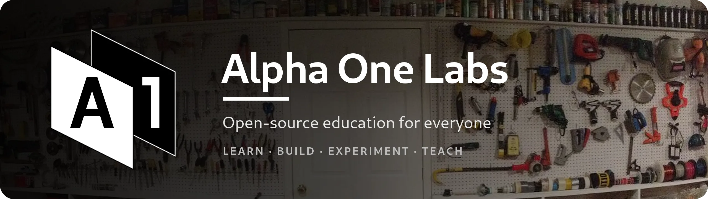
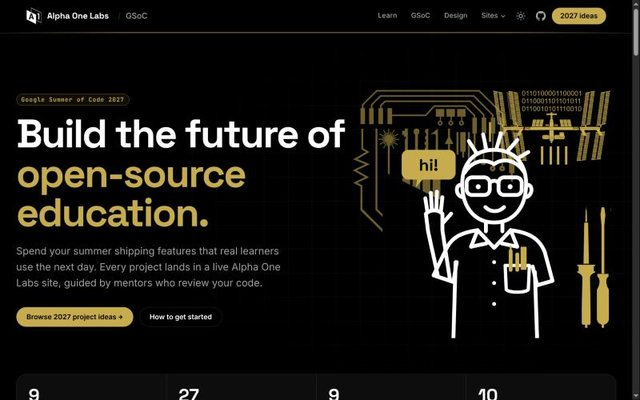
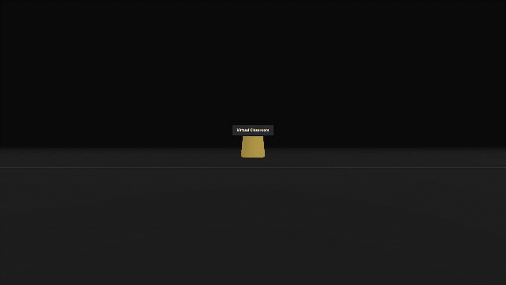
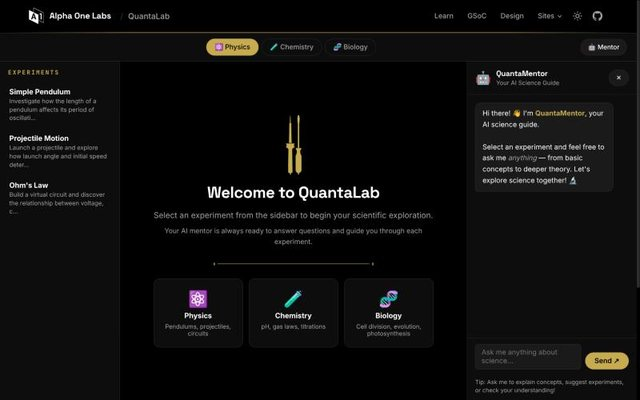
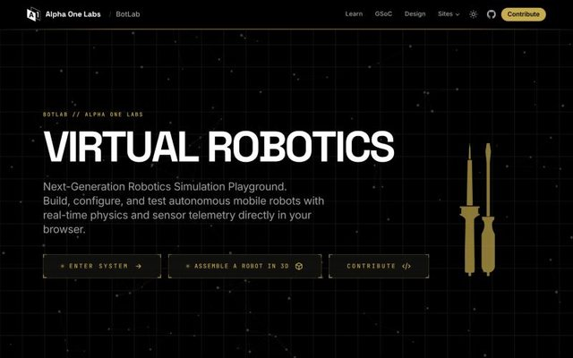
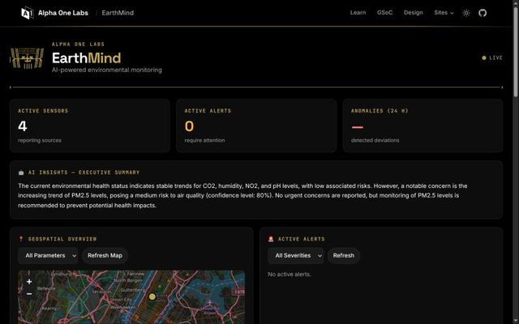
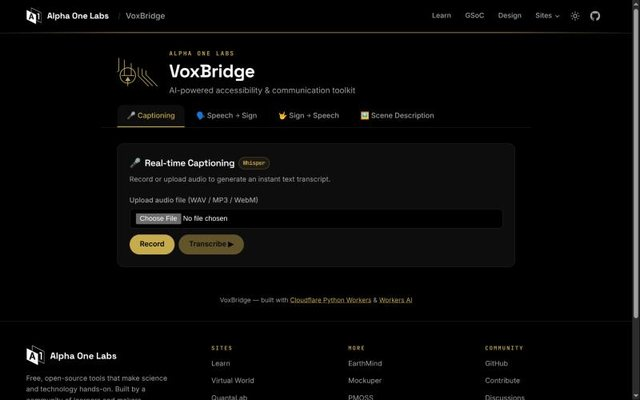
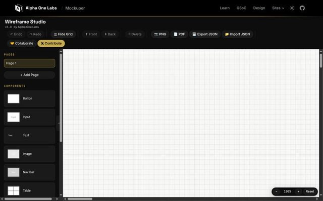

<div align="center">



<br>

### We build free, open-source tools that make science and technology hands-on.

<sub>Interactive labs · AI tutors · live classrooms · a learning platform anyone can join</sub>

<br>

[**alphaonelabs.com**](https://alphaonelabs.com) &nbsp;·&nbsp; [**Start learning**](https://learn.alphaonelabs.com) &nbsp;·&nbsp; [**GSoC 2027 ideas**](https://gsoc.alphaonelabs.com/ideas) &nbsp;·&nbsp; [**Contribute**](https://github.com/alphaonelabs/website/blob/main/CONTRIBUTING.md) &nbsp;·&nbsp; [**Discussions**](https://github.com/orgs/alphaonelabs/discussions)

<br>


[](https://github.com/alphaonelabs/website)
[](https://gsoc.alphaonelabs.com)
[](https://hacktoberfest.com)

</div>

<br>

## 🌐 Live sites

<table>
  <tr>
    <td width="50%" valign="top">
      <a href="https://learn.alphaonelabs.com"></a>
      <h3><a href="https://learn.alphaonelabs.com">Learn</a></h3>
      Our learning platform: browse activities, join live virtual classrooms, take quizzes and earn certificates.<br>
      <sub><a href="https://github.com/alphaonelabs/website/tree/main/learn"><code>learn/</code></a> · <a href="https://learn.alphaonelabs.com">learn.alphaonelabs.com</a></sub>
    </td>
    <td width="50%" valign="top">
      <a href="https://gsoc.alphaonelabs.com"></a>
      <h3><a href="https://gsoc.alphaonelabs.com">GSoC 2027</a></h3>
      Google Summer of Code with us: ten project ideas, how to start, and the season leaderboards.<br>
      <sub><a href="https://github.com/alphaonelabs/website/tree/main/gsoc"><code>gsoc/</code></a> · <a href="https://gsoc.alphaonelabs.com">gsoc.alphaonelabs.com</a></sub>
    </td>
  </tr>
  <tr>
    <td width="50%" valign="top">
      <a href="https://virtual.alphaonelabs.com"></a>
      <h3><a href="https://virtual.alphaonelabs.com">Virtual World</a></h3>
      A 3D world built with three.js. Walk up to a portal and step into a live classroom. Explore as a guest, no sign-in needed.<br>
      <sub><a href="https://github.com/alphaonelabs/website/tree/main/virtual"><code>virtual/</code></a> · <a href="https://virtual.alphaonelabs.com">virtual.alphaonelabs.com</a></sub>
    </td>
    <td width="50%" valign="top">
      <a href="https://quantalab.alphaonelabs.com"></a>
      <h3><a href="https://quantalab.alphaonelabs.com">QuantaLab</a></h3>
      A virtual science lab for physics, chemistry and biology, with an AI mentor that explains what you see.<br>
      <sub><a href="https://github.com/alphaonelabs/website/tree/main/quantalab"><code>quantalab/</code></a> · <a href="https://quantalab.alphaonelabs.com">quantalab.alphaonelabs.com</a></sub>
    </td>
  </tr>
  <tr>
    <td width="50%" valign="top">
      <a href="https://botlab.alphaonelabs.com"></a>
      <h3><a href="https://botlab.alphaonelabs.com">BotLab</a></h3>
      A robotics playground: build, configure and test robots with real-time physics, in 2D and 3D.<br>
      <sub><a href="https://github.com/alphaonelabs/website/tree/main/botlab"><code>botlab/</code></a> · <a href="https://botlab.alphaonelabs.com">botlab.alphaonelabs.com</a></sub>
    </td>
    <td width="50%" valign="top">
      <a href="https://earthmind.alphaonelabs.com"></a>
      <h3><a href="https://earthmind.alphaonelabs.com">EarthMind</a></h3>
      Environmental monitoring with live maps, anomaly alerts and AI summaries of sensor data.<br>
      <sub><a href="https://github.com/alphaonelabs/website/tree/main/earthmind"><code>earthmind/</code></a> · <a href="https://earthmind.alphaonelabs.com">earthmind.alphaonelabs.com</a></sub>
    </td>
  </tr>
  <tr>
    <td width="50%" valign="top">
      <a href="https://voxbridge.alphaonelabs.com"></a>
      <h3><a href="https://voxbridge.alphaonelabs.com">VoxBridge</a></h3>
      AI accessibility tools: live captioning, speech-to-sign, sign-to-speech and scene description.<br>
      <sub><a href="https://github.com/alphaonelabs/website/tree/main/voxbridge"><code>voxbridge/</code></a> · <a href="https://voxbridge.alphaonelabs.com">voxbridge.alphaonelabs.com</a></sub>
    </td>
    <td width="50%" valign="top">
      <a href="https://mockuper.alphaonelabs.com"></a>
      <h3><a href="https://mockuper.alphaonelabs.com">Mockuper</a></h3>
      A wireframe studio for quick, clean mockups, with pages, components and exports.<br>
      <sub><a href="https://github.com/alphaonelabs/website/tree/main/mockuper"><code>mockuper/</code></a> · <a href="https://mockuper.alphaonelabs.com">mockuper.alphaonelabs.com</a></sub>
    </td>
  </tr>
</table>

<p align="center">
  <b>Also live:</b>
  <a href="https://pmoss.alphaonelabs.com">📋 PMOSS</a> ·
  <a href="https://design.alphaonelabs.com">🎨 Design system</a>, the A1 mark, colors, components and maker art every site is built on
</p>

<br>

## ☀️ Google Summer of Code 2027

<table>
  <tr>
    <td valign="top" width="33%">
      <b>🎥 Live classrooms</b><br>
      <sub>Real audio, video and captions in learn's virtual classroom, built on Cloudflare Realtime and VoxBridge.</sub>
    </td>
    <td valign="top" width="33%">
      <b>🧠 Course-grounded AI tutor</b><br>
      <sub>Answers only from a course's own materials, cites its sources, and follows the teacher's rules.</sub>
    </td>
    <td valign="top" width="33%">
      <b>📴 Offline-first learning</b><br>
      <sub>Download a course on Wi-Fi and finish it anywhere, with progress that syncs later.</sub>
    </td>
  </tr>
</table>

<p align="center"><a href="https://gsoc.alphaonelabs.com/ideas"><b>See all 10 project ideas →</b></a> &nbsp;·&nbsp; <sub>Priority goes to applicants with 5 merged PRs</sub></p>

<br>

## 🧪 Everything we build, in one repo

> Every project lives in its own folder in [`alphaonelabs/website`](https://github.com/alphaonelabs/website). Push to `main` and its site deploys.

<table>
  <tr>
    <th align="left">🔬 Labs & worlds</th>
    <th align="left">🧠 AI for learning</th>
    <th align="left">🛠️ Platform & tools</th>
  </tr>
  <tr>
    <td valign="top">

[QuantaLab](https://github.com/alphaonelabs/website/tree/main/quantalab) · science experiments<br>
[BotLab](https://github.com/alphaonelabs/website/tree/main/botlab) · robotics playground<br>
[Virtual](https://github.com/alphaonelabs/website/tree/main/virtual) · 3D world<br>
[Virtual Labs](https://github.com/alphaonelabs/website/tree/main/virtual-labs) · experiments

</td>
    <td valign="top">

[LearnPilot](https://github.com/alphaonelabs/website/tree/main/learnpilot) · adaptive tutoring<br>
[ScholarAI](https://github.com/alphaonelabs/website/tree/main/scholarai) · research assistant<br>
[Syntharia](https://github.com/alphaonelabs/website/tree/main/syntharia) · creative AI studio<br>
[EarthMind](https://github.com/alphaonelabs/website/tree/main/earthmind) · environment AI<br>
[VoxBridge](https://github.com/alphaonelabs/website/tree/main/voxbridge) · accessibility AI

</td>
    <td valign="top">

[Learn](https://github.com/alphaonelabs/website/tree/main/learn) · learning platform<br>
[App](https://github.com/alphaonelabs/website/tree/main/app) · Flutter app<br>
[Design System](https://github.com/alphaonelabs/website/tree/main/design-system) · UI & brand<br>
[Mockuper](https://github.com/alphaonelabs/website/tree/main/mockuper) · wireframes<br>
[PMOSS](https://github.com/alphaonelabs/website/tree/main/pmoss) · project management

</td>
  </tr>
</table>

```bash
git clone https://github.com/alphaonelabs/website.git
cd website/learn        # or any project folder
```

<br>

## 🤝 Get involved

<table>
  <tr>
    <td align="center" width="25%">🌱<br><b>New here?</b><br><a href="https://github.com/alphaonelabs/website/issues?q=is%3Aopen+is%3Aissue+label%3A%22good+first+issue%22">Good first issues</a></td>
    <td align="center" width="25%">🐛<br><b>Found a bug?</b><br><a href="https://github.com/alphaonelabs/website/issues/new/choose">Open an issue</a></td>
    <td align="center" width="25%">💡<br><b>Have an idea?</b><br><a href="https://github.com/orgs/alphaonelabs/discussions">Start a discussion</a></td>
    <td align="center" width="25%">🔧<br><b>Ready to code?</b><br><a href="https://github.com/alphaonelabs/website/blob/main/CONTRIBUTING.md">Contributing guide</a></td>
  </tr>
</table>

### 💜 Built by our contributors

<!-- CONTRIBUTORS_START -->

<a href="https://github.com/A1L13N" title="A1L13N"></a> <a href="https://github.com/ishaan-arora-1" title="ishaan-arora-1"></a> <a href="https://github.com/10done" title="10done"></a> <a href="https://github.com/ghanshyam2005singh" title="ghanshyam2005singh"></a> <a href="https://github.com/Ananya44444" title="Ananya44444"></a> <a href="https://github.com/Shubhashish-Chakraborty" title="Shubhashish-Chakraborty"></a> <a href="https://github.com/bits-and-atoms" title="bits-and-atoms"></a> <a href="https://github.com/sayanoops" title="sayanoops"></a> <a href="https://github.com/rishavvrajj" title="rishavvrajj"></a> <a href="https://github.com/Lakshya-2440" title="Lakshya-2440"></a> <a href="https://github.com/varruunnn" title="varruunnn"></a> <a href="https://github.com/chinnu8055" title="chinnu8055"></a> <a href="https://github.com/gopikrishna-20" title="gopikrishna-20"></a> <a href="https://github.com/Satyamkumarnavneet" title="Satyamkumarnavneet"></a> <a href="https://github.com/Inshamhaque" title="Inshamhaque"></a> <a href="https://github.com/ayesha1145" title="ayesha1145"></a> <a href="https://github.com/abdelrahman390" title="abdelrahman390"></a> <a href="https://github.com/Shrey1006" title="Shrey1006"></a> <a href="https://github.com/ATHARVA-GAWAS" title="ATHARVA-GAWAS"></a> <a href="https://github.com/Flashl3opard" title="Flashl3opard"></a> <a href="https://github.com/GautamSharmaaa" title="GautamSharmaaa"></a> <a href="https://github.com/IITI-tushar" title="IITI-tushar"></a> <a href="https://github.com/AndyVale" title="AndyVale"></a> <a href="https://github.com/HarishKarthickS" title="HarishKarthickS"></a> <a href="https://github.com/shivanshshri" title="shivanshshri"></a> <a href="https://github.com/AkhileshJyotishi" title="AkhileshJyotishi"></a> <a href="https://github.com/Taha254511" title="Taha254511"></a> <a href="https://github.com/sudhirKsah" title="sudhirKsah"></a> <a href="https://github.com/Abhishek-Punhani" title="Abhishek-Punhani"></a> <a href="https://github.com/abdulateeb" title="abdulateeb"></a> <a href="https://github.com/Aaravanand00" title="Aaravanand00"></a> <a href="https://github.com/Ashutoshx7" title="Ashutoshx7"></a> <a href="https://github.com/Nishantsingh11" title="Nishantsingh11"></a> <a href="https://github.com/omsherikar" title="omsherikar"></a> <a href="https://github.com/PranavGadge01" title="PranavGadge01"></a> <a href="https://github.com/pulkitgxrg" title="pulkitgxrg"></a> <a href="https://github.com/Rahul-98112005" title="Rahul-98112005"></a> <a href="https://github.com/SfarOussama9" title="SfarOussama9"></a> <a href="https://github.com/syedubaid11" title="syedubaid11"></a> <a href="https://github.com/tarunagnihotri534" title="tarunagnihotri534"></a> <a href="https://github.com/Vrushti07" title="Vrushti07"></a> <a href="https://github.com/debadityaroy99" title="debadityaroy99"></a> <a href="https://github.com/meyyy03" title="meyyy03"></a> <a href="https://github.com/mintxdp" title="mintxdp"></a> <a href="https://github.com/skanbedoui" title="skanbedoui"></a> <a href="https://github.com/Neeraj-gagat" title="Neeraj-gagat"></a> <a href="https://github.com/alimurtzaa" title="alimurtzaa"></a> <a href="https://github.com/Legacywave1" title="Legacywave1"></a> <a href="https://github.com/KhushamBansal" title="KhushamBansal"></a> <a href="https://github.com/Keerthi421" title="Keerthi421"></a> <a href="https://github.com/huda-code" title="huda-code"></a> <a href="https://github.com/Coder-Harshit" title="Coder-Harshit"></a> <a href="https://github.com/Dhairya1890" title="Dhairya1890"></a> <a href="https://github.com/Ankushkr14" title="Ankushkr14"></a> <a href="https://github.com/Akarshkushwaha" title="Akarshkushwaha"></a> <a href="https://github.com/ajaykumar246" title="ajaykumar246"></a> <a href="https://github.com/Aaqilyousuf" title="Aaqilyousuf"></a> <a href="https://github.com/ASureeva" title="ASureeva"></a>

<!-- CONTRIBUTORS_END -->

<sub><a href="https://github.com/alphaonelabs/website/graphs/contributors">See everyone on GitHub →</a></sub>

<br>

## 📊 At a glance

<div align="center">

<!-- STATS_START -->

[](https://github.com/alphaonelabs) [](https://github.com/orgs/alphaonelabs/repositories) [](https://github.com/pulls?q=is%3Aopen+is%3Apr+user%3Aalphaonelabs) [](https://github.com/issues?q=is%3Aopen+is%3Aissue+user%3Aalphaonelabs) [](https://github.com/orgs/alphaonelabs/repositories)

<!-- STATS_END -->

<br>


</div>

<details>
<summary><b>📚 Repositories</b> (updated daily)</summary>

<!-- REPOS_START -->

| Repository | Description | Language | Stars | Forks | Open PRs | Open Issues | Commits |
|---|---|---|---|---|---|---|---|
| [website](https://github.com/alphaonelabs/website) | Alpha One Labs Educational Website | HTML | ⭐ 66 | 🍴 180 | 🔀 0 | 🐛 11 | 💾 1472 |
| [.github](https://github.com/alphaonelabs/.github) | Github Repo | Python | ⭐ 0 | 🍴 0 | 🔀 0 | 🐛 0 | 💾 289 |

<!-- REPOS_END -->

</details>

<br>

<div align="center">
  
  <br>
  <sub>Made with ❤️ by the Alpha One Labs community · MIT licensed · ⭐ <a href="https://github.com/alphaonelabs/website">Star the monorepo</a> to follow along</sub>
</div>
